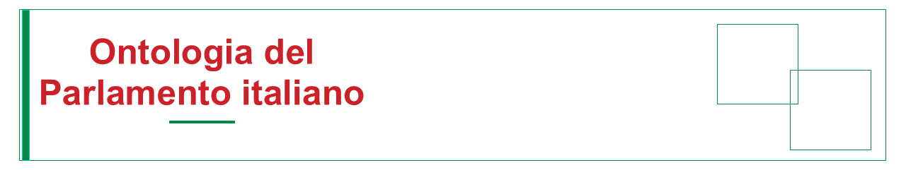
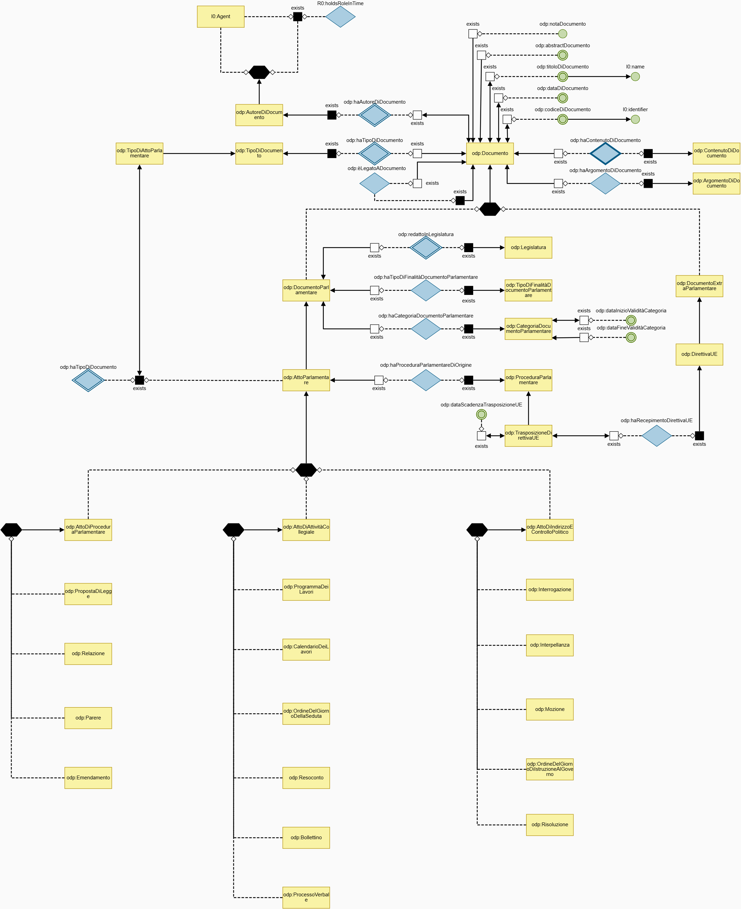
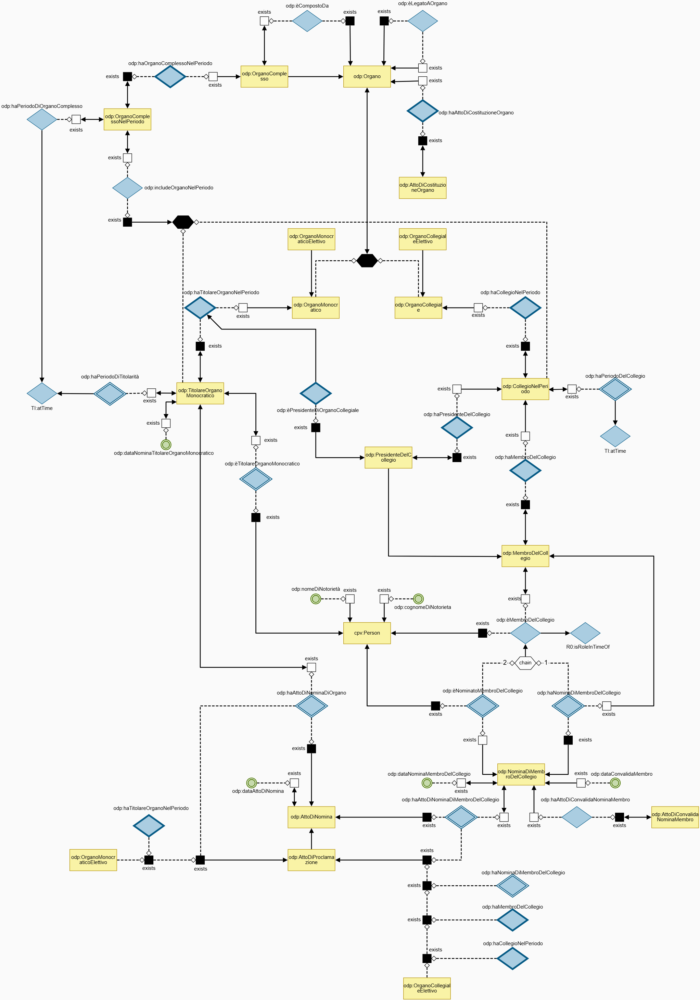
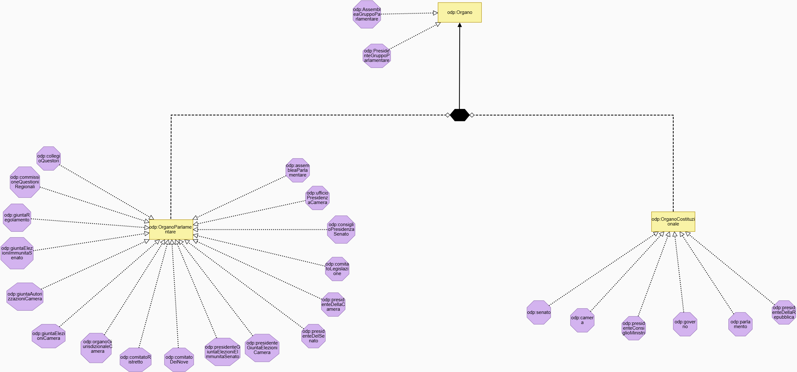
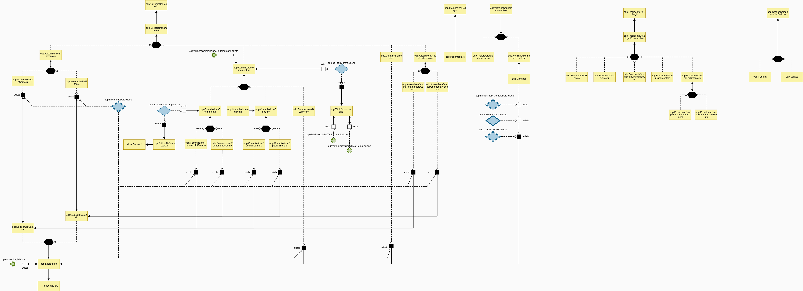
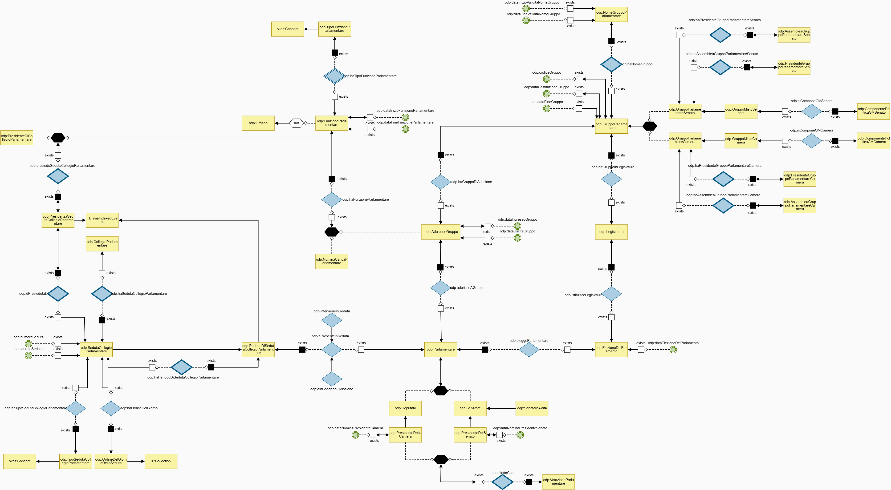
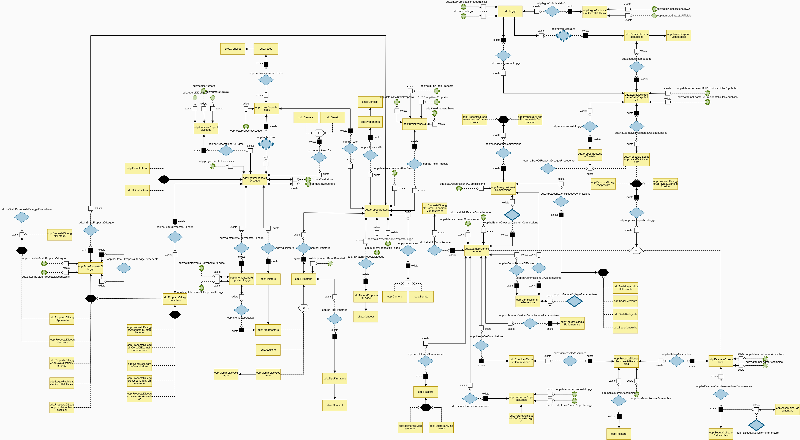
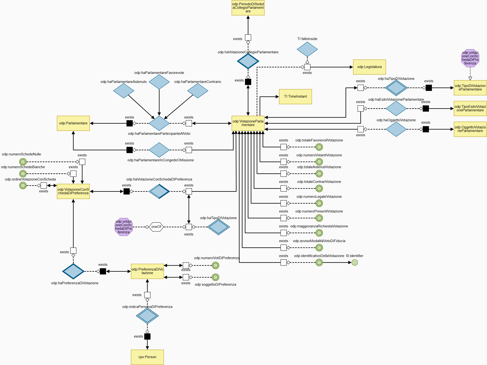

<h1 align="center">
  
</h1>

<p align="center">
  <a href="https://w3id.org/italia/Parlamento"></a>
  <a href="https://schema.gov.it"></a>
  
  </p>

---

## Premessa
Questo repository ha finalità di sviluppo e sperimentazione. 
I contenuti pubblicati — inclusi l’ontologia del Parlamento e i documenti di lavoro correlati — costituiscono versioni preliminari e non ancora validati da Camera dei deputati e Senato della Repubblica. 
**I contenuti pubblicati non devono pertanto essere considerati contenuti ufficiali o definitivi.**

## Descrizione
L'ontologia descrive in modo strutturato e formale il dominio del **Parlamento italiano**, con lo scopo di rappresentarne gli elementi fondamentali, le relazioni istituzionali e i processi che ne caratterizzano il funzionamento. È concepita per fornire un quadro delle entità concettuali che modellano **attività parlamentari**.

L’Ontologia è organizzata in **moduli tematici**, ognuno dedicato a un aspetto specifico del dominio. Attraverso l’uso di classi e proprietà riflette la prassi istituzionale e normativa distinguendo ruoli, competenze e procedure, rendendo così chiari i legami tra soggetti, atti e fasi procedurali.

Il namespace persistente ipotizzato `w3id.org/italia/Parlamento` sarà registrato secondo il modello *domain-contributor* del namespace nazionale `w3id.org/italia`. L'ontologia riusa ontologie CORE: CPV, TI e SKOS della rete semantica del **Catalogo Nazionale dei dati semantici ([schema.gov.it](https://schema.gov.it))**.


## URI persistenti
| Risorsa | URI |
|---|---|
| Ontologia | `https://w3id.org/italia/Parlamento` | <!-- URI provvisorio -->
| Vocabolari controllati | `https://w3id.org/italia/controlled-vocabulary/{nome}` | <!-- URI provvisorio -->

Gli URI supportano la *content negotiation*: per l'ontologia, le richieste con `Accept` RDF (`text/turtle`, `application/rdf+xml`, `application/n-triples`) risolvono alle serializzazioni pubblicate in questo repository; per i vocabolari controllati sono negoziabili Turtle (`text/turtle`) e CSV (`text/csv`). Le richieste HTML rinviano alla documentazione sul Catalogo Nazionale dei dati semantici, disponibile a valle dell'indicizzazione.

## Struttura del repository
```
ontologia-parlamento-italiano/
├── README.md
├── assets/
│   ├── ontologies/
│   │   └── parlamento/
│   │       ├── latest/                  	← parlamento.{ttl,rdf,json-ld,graphol}
│   │       └── v25/                    	← copia immutabile della versione rilasciata
│   └── controlled-vocabularies/
│       └── README.md  
└── documents/							 	← Descrizione dell'ontologia, graphol, ELI-ELI-DL mapping
    └── images/                          	← loghi e immagini visualizzati nel README
        └── Moduli_Ontologia_Parlamento/    ← moduli dell'ontologia visualizzati nel README
```

## Moduli tematici
Di seguito sono rappresentati i moduli che compongono l'ontologia del Parlamento italiano.
Il file .graphol completo è contenuto nella cartella `assets/ontologies/parlamento/latest/` 

### Documenti
Questa porzione dell’ontologia descrive in modo strutturato le tipologie di documenti relativi all’attività parlamentare italiana. 
Lo scopo è fornire una rappresentazione coerente delle entità documentali prodotte nell’ambito del Parlamento (e di quelle correlate prodotte all’esterno), delle loro caratteristiche descrittive (titolo, data, codice, abstract, autore, contenuto, argomento) e delle relazioni che le collegano a procedure, categorie e ad altri documenti. 

<h1 align="center">
  
</h1>

### Organo  
Questa porzione dell'ontologia descrive il dominio degli organi, delle persone che ne fanno parte e degli atti formali che ne regolano la costituzione e le nomine. 
Il suo scopo è rappresentare in modo strutturato concetti quali gli uffici (organi), le loro tipologie, i ruoli ricoperti (ad esempio membri, presidenti, titolari monocratici), i periodi di esercizio della titolarità e gli atti che stabiliscono o convalidano tali ruoli. L’organizzazione dei concetti consente di legare persone, uffici, atti e periodi temporali in modo coerente, facilitando l’uso dei dati per consultazione, integrazione e interoperabilità.

<h1 align="center">
  
</h1>

### Organo parlamentare

Questa porzione dell'ontologia descrive la struttura istituzionale e i ruoli del Parlamento italiano, modellando classi, proprietà e vincoli che rappresentano commissioni, assemblee, collegi e le funzioni connesse ai loro titolari e membri. 
Lo scopo è fornire una rappresentazione formale e coerente delle entità parlamentari (come Camera, Senato, commissioni permanenti e speciali, assemblee di gruppo, giunte e cariche monocratiche) e delle relazioni principali che le collegano, in modo da rendere espliciti elementi quali titoli, periodi di validità, numerazione e competenze tematiche.

<h1 align="center">
  
</h1>

### Gerarchia organi

Questa porzione dell’ontologia presenta la gerarchia degli organi, distinguendo gli organi parlamentari dagli organi costituzionali e mostrando la loro relazione con la classe generale «Organo». 
Il diagramma elenca inoltre specifici organi, tra cui assemblee, giunte, comitati, presidenze e istituzioni costituzionali, mettendone in evidenza la classificazione nel modello.

<h1 align="center">
  
</h1>

### Funzioni del Parlamento

Questa porzione di ontologia descrive, nell’ambito del dominio del Parlamento italiano, in modo strutturato i soggetti, le istituzioni e le attività che ne caratterizzano il funzionamento. 
Il modello include sia organi collegiali che organi monocratici afferenti alla figura del parlamentare, quale titolare di specifiche cariche, nonché delle articolazioni collettive (gruppi parlamentari e loro organi), delle sedute dei collegi parlamentari, votazioni, elezioni e legislatura. 
Attraverso classi dedicate e relazioni fra di esse, l’ontologia consente di rappresentare appartenenze, ruoli, periodi temporali e azioni tipiche del contesto parlamentare, nonché di associare metadati rilevanti come date di nomina, inizio o fine di funzioni e validità di denominazioni di gruppo.

<h1 align="center">
  
</h1>

#### Iter legislativo

Questa porzione di ontologia descrive in modo organizzato il ciclo di vita e gli elementi informativi connessi al percorso per l’approvazione delle leggi (dall’iniziativa legislativa all’approvazione) nell’ambito del Parlamento italiano. 
Lo scopo è fornire un modello che rappresenti tutte le entità coinvolte (proposte, testi, leggi, commissioni, sedute, organi e ruoli parlamentari) e le relazioni che collegano tali entità, insieme agli attributi documentali inerenti al processo legislativo (date, numeri, titoli, testi). 
L’ontologia definisce classi quali «Proposta di legge», «Legge», «Commissione parlamentare» e «Seduta», nonché ruoli quali «Firmatario», «Relatore» e «Presidente della Repubblica».

<h1 align="center">
  
</h1>

### Votazione

Questa porzione dell’ontologia Parlamento descrive il dominio delle votazioni parlamentari nell'ambito del Parlamento italiano, con particolare attenzione alla rappresentazione formale degli eventi di voto, delle loro tipologie, degli esiti, degli oggetti sottoposti a votazione e dei partecipanti. 
Lo scopo è fornire un modello coerente per rappresentare sia le informazioni qualitative (ad esempio la tipologia di votazione e il risultato) sia i dati numerici che caratterizzano ogni votazione (quali il numero dei presenti, dei votanti e delle schede).

<h1 align="center">
  
</h1>


## Serializzazioni

| Formato | File | Uso |
|---|---|---|
| Turtle | `parlamento.ttl` | formato di riferimento |
| RDF/XML | `parlamento.rdf` | interoperabilità, import in tool (es. Protégé) |
| JSON-LD | `parlamento.json-ld` | integrazione in applicazioni web |
| Graphol | `parlamento.graphol` | sorgente del modello (Eddy/Graphol) |

## Come citare

> Parlamento — ...... *Ontologia del Parlamento italiano (italian Parliament)*, v25 (2026). URI: https://w3id.org/italia/Parlamento

## Ringraziamenti

<p align="center">
  
  &nbsp;&nbsp;&nbsp;&nbsp;&nbsp;
</p>
